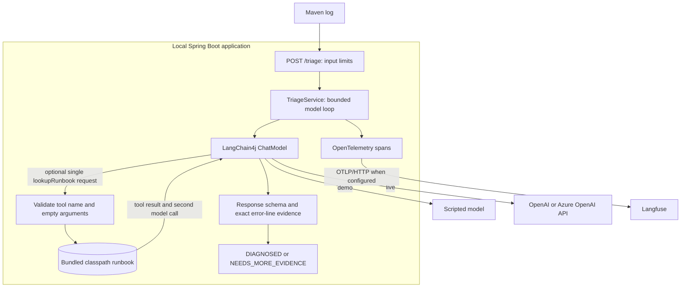

# Java CI Triage Agent

Maven build failure triage with Spring Boot, LangChain4j and Langfuse.

`POST /triage` accepts a Maven build log. The model can call `lookupRunbook` once to
read a bundled troubleshooting guide, then returns only a status and, for a diagnosis,
a quote from the log. The Java application validates the tool call and accepts a
diagnosis only when the guide was read and the quote comes from a line that starts
with `[ERROR]` (after an optional GitHub Actions timestamp) and shows the symptom
the runbook describes. The diagnosis and the suggested
next step for a human come from the runbook, not from the model, so text in a build
log cannot change what the service tells a person to do. The only tool reads a
classpath resource.

## Architecture

The Spring Boot service runs on localhost. Demo mode scripts model replies; live mode uses OpenAI or Azure OpenAI through LangChain4j. A diagnosis requires the one allowed runbook lookup and verbatim evidence on an error line. Traces omit raw logs and prompts.



## Why a tool for a constant runbook?

The runbook could be pasted into the prompt. It is exposed as a tool on purpose: the
point of this PoC is the control loop around an LLM, not the diagnosis itself.

- **Provenance.** `DIAGNOSED` is accepted only if the model actually called
  `lookupRunbook`. The application records which runbook grounded the answer.
- **Budget.** Exactly one tool call with an empty argument object. A second call, an
  unexpected tool or stray arguments fail the request.
- **Observability.** Langfuse shows the runbook lookup as its own observation between
  the two model calls, so the trace reads like the decision it represents.

## Run locally

Use Java 21 and Maven 3.9+. Start in the default demo mode, which uses scripted model
responses and requires no account, API key or paid calls.

```bash
mvn -B -ntp verify
mvn spring-boot:run
```

In another terminal (Bash, curl and jq):

```bash
for log in examples/known-jdk-mismatch.log examples/insufficient-evidence.log; do
  jq -n --rawfile log "$log" '{log: $log}' |
    curl -fsS http://127.0.0.1:8080/triage \
      -H 'Content-Type: application/json' --data-binary @- | jq
done
```

| Fixture | Expected status | Expected behavior |
| --- | --- | --- |
| `known-jdk-mismatch.log` | `DIAGNOSED` | Reads `MAVEN-JDK-001`, quotes the compiler error and returns the runbook's next step: check the CI JDK and Maven toolchain. |
| `insufficient-evidence.log` | `NEEDS_MORE_EVIDENCE` | Returns a fixed request for the first compiler error and `mvn -version`. The scripted model skips the runbook. |

A diagnosed response looks like this:

```json
{
  "status": "DIAGNOSED",
  "diagnosis": "The compiler selected by Maven does not support the requested Java release.",
  "evidence": "error: release version 21 not supported",
  "nextStep": "Check mvn -version on the CI runner and the JDK selected by any Maven toolchain. Use a JDK that supports the requested release, then rerun the build.",
  "runbookId": "MAVEN-JDK-001",
  "traceId": "3f1c…"
}
```

Invalid input returns HTTP 400. A provider failure or an invalid model response returns
HTTP 502; the reason is logged with the `traceId` so it can be matched to the trace.
The service binds to localhost and accepts logs up to 12,000 characters.

## Response validation

The model output is a contract, not an answer. Before anything is returned:

- The model may return only `status` and `evidence` in a single JSON object.
  Unknown fields, Markdown fences and trailing content are rejected.
- `DIAGNOSED` requires a prior runbook lookup and evidence showing the runbook symptom.
- Evidence must appear verbatim on a line starting with `[ERROR]`, optionally after
  a GitHub Actions timestamp. An embedded `[ERROR]` marker in an `[INFO]` line is rejected.
- The diagnosis and next step come from the bundled runbook, not model-written advice.
- `NEEDS_MORE_EVIDENCE` may not carry evidence; its next step is fixed by the service.

Any violation is a 502 with a fixed, non-sensitive reason in the log and in the
`validate-response` span.

## Live model and Langfuse

Set `TRIAGE_MODE=live` and choose a provider with `TRIAGE_PROVIDER`:

| Provider | Required environment | Model selection |
| --- | --- | --- |
| `openai` (default) | `OPENAI_API_KEY` | `OPENAI_MODEL`, default `gpt-4.1-mini` |
| `azure` | `AZURE_OPENAI_ENDPOINT`, `AZURE_OPENAI_API_KEY`, `AZURE_OPENAI_DEPLOYMENT` | Your Azure deployment name, not necessarily the underlying model ID |

Both providers use JSON mode, a 450-token output limit per call, a 15-second request
timeout and no automatic retries. Live mode sends the submitted log to the selected
provider and can incur charges. Use the synthetic fixtures for validation. An invalid
Azure configuration fails locally; it never falls back to the public OpenAI API.

### Use an existing Azure OpenAI deployment

The app stays on your computer. No App Service, AKS or other Azure infrastructure is
created. Set the following in Bash or Git Bash, replacing the endpoint and deployment
with your existing resource values:

```bash
export TRIAGE_MODE=live
export TRIAGE_PROVIDER=azure
export AZURE_OPENAI_ENDPOINT="https://YOUR-RESOURCE.openai.azure.com"
export AZURE_OPENAI_DEPLOYMENT="YOUR-DEPLOYMENT"
read -rsp "Azure OpenAI API key: " AZURE_OPENAI_API_KEY
echo
export AZURE_OPENAI_API_KEY
mvn spring-boot:run
```

The key input is hidden and its value is not included in shell history. Keep that
terminal open for the application. The endpoint may be a resource URL or its
`/openai/v1/` base URL. Deployment-specific URLs and query strings are rejected.

This integration uses Azure's [v1 Chat Completions API](https://learn.microsoft.com/azure/ai-foundry/openai/api-version-lifecycle),
the deployment name in `model`, and the `api-key` header. It needs no `api-version`
parameter or additional Azure SDK dependency. Use a deployment supporting chat
completions, tool calling, JSON mode and `max_tokens`, such as GPT-4.1 mini.
API key authentication must be enabled on the resource; Entra ID authentication is
not implemented in this initial integration.

### Optional Langfuse tracing

For either mode, set `LANGFUSE_PUBLIC_KEY` and `LANGFUSE_SECRET_KEY` for your
project. `LANGFUSE_HOST` defaults to `https://cloud.langfuse.com`. Restart the
application after changing environment variables. In Langfuse, find the returned
`traceId`. The known failure shows two model calls around the runbook lookup.
Both paths show a `validate-response` span and the final status. Spans export
via OTLP/HTTP and contain the runbook ID and validation outcome. Raw logs, prompts,
tool arguments, runbook text and model answers stay out of the spans and out of the
application log.

## Scope and limits

Runtime validation checks the response contract and evidence provenance. The model may
return only `status` and `evidence`; any other field, Markdown around the JSON, or an
abstention that cites evidence is rejected. The offline tests check the expected outcome
for each fixture and exercise invalid tool calls, schemas and evidence. A local OTLP receiver test checks the
export request and verifies the trace omits raw log text. Real model responses can vary.
This PoC covers one Maven failure class. A fabricated error line can still trigger
a diagnosis. The diagnosis and next step remain fixed runbook text, and the evidence
field quotes untrusted log data.

[Local validation, 26 November 2026](evidence/validation-2026-11-26.md): 28 tests
passed, one live evaluation skipped, and both fixture endpoints passed a demo HTTP
smoke test. Cloud Langfuse ingestion and real model quality remain unverified.

## Evaluation

`eval/cases` holds synthetic logs grouped by the expected status, `diagnosed` and
`needs-more-evidence`. They include near misses (another compiler error, a test that
prints the symptom) and logs with injected instructions. `EvalCasesTest` runs them in
every build against scripted models: for each negative case, a model that reads the
runbook and quotes any line of the log as evidence must still be rejected.

To measure a live model, run each case several times:

```bash
mvn -B -ntp test -Dtest=LiveEvalTest -Deval.live=true -Deval.runs=3
```

The evaluation uses the same provider environment as the application, including
`TRIAGE_PROVIDER=azure` and the `AZURE_OPENAI_*` values for Azure. Its report records
the provider and model or deployment name. This sends the synthetic logs to the
selected provider and can incur charges. The test
writes `target/eval-report.md` with the outcomes per case: the returned status, a
guardrail rejection with its reason, or a provider error. Set `eval.runs` to a positive
integer. The test fails on any provider error, any diagnosis of a negative case, or
any case without at least one correct response. With the Langfuse keys set, the runs
are traced as well.

- [LangChain4j tool calling](https://docs.langchain4j.dev/tutorials/tools/)
- [Langfuse OpenTelemetry integration](https://langfuse.com/integrations/native/opentelemetry)

## License

MIT, see [LICENSE](LICENSE).
