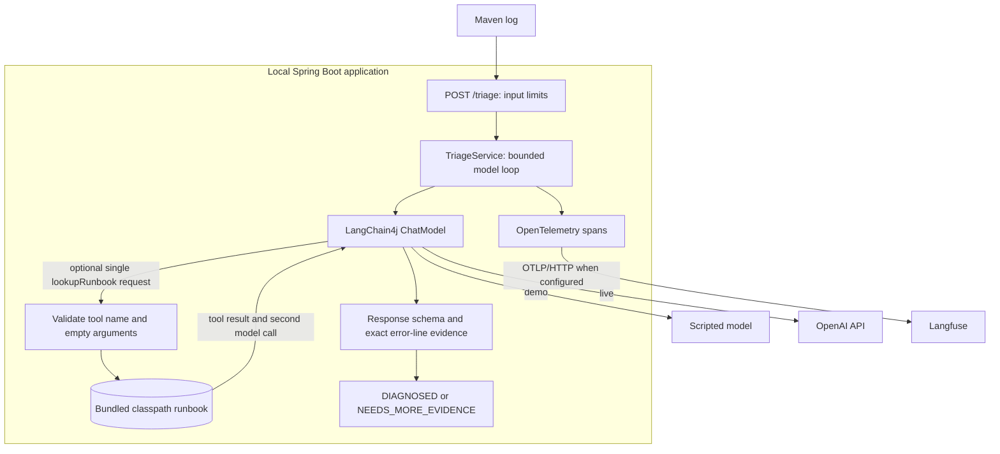

# Java CI Triage Agent

Maven build failure triage with Spring Boot, LangChain4j and Langfuse.

`POST /triage` accepts a Maven build log. The model can call `lookupRunbook` once to
read a bundled troubleshooting guide. The Java application validates the tool call
and accepts a diagnosis only when the guide was read and the cited evidence appears
verbatim on an error line of the log. The response includes a suggested next step for
a human. The only tool reads a classpath resource.

## Architecture

The Spring Boot service runs on localhost. Demo mode scripts model replies; live mode uses OpenAI through LangChain4j. A diagnosis requires the one allowed runbook lookup and verbatim evidence on an error line. Traces omit raw logs and prompts.



## Why a tool for a constant runbook?

The runbook could be pasted into the prompt. It is exposed as a tool on purpose: the
point of this PoC is the control loop around an LLM, not the diagnosis itself.

- **Provenance.** `DIAGNOSED` is accepted only if the model actually called
  `lookupRunbook`. The application records which runbook grounded the answer.
- **Budget.** Exactly one tool call with an empty argument object. A second call, an
  unexpected tool or stray arguments fail the request.
- **Observability.** Langfuse shows the runbook lookup as its own observation between
  the two model calls, so the trace reads like the decision it represents.

## Run locally

Use Java 21 and Maven 3.9+. Start in the default demo mode, which uses scripted model
responses and requires no account, API key or paid calls.

```bash
mvn -B -ntp verify
mvn spring-boot:run
```

In another terminal (Bash, curl and jq):

```bash
for log in examples/known-jdk-mismatch.log examples/insufficient-evidence.log; do
  jq -n --rawfile log "$log" '{log: $log}' |
    curl -fsS http://127.0.0.1:8080/triage \
      -H 'Content-Type: application/json' --data-binary @- | jq
done
```

| Fixture | Expected status | Expected behavior |
| --- | --- | --- |
| `known-jdk-mismatch.log` | `DIAGNOSED` | Reads `MAVEN-JDK-001`, quotes the compiler error and suggests checking the CI JDK and Maven toolchain. |
| `insufficient-evidence.log` | `NEEDS_MORE_EVIDENCE` | Asks for the first compiler error and `mvn -version`. The scripted model skips the runbook. |

A diagnosed response looks like this:

```json
{
  "status": "DIAGNOSED",
  "diagnosis": "The compiler selected by Maven does not support Java release 21.",
  "evidence": "error: release version 21 not supported",
  "nextStep": "Check mvn -version and the Maven toolchain on CI. Select a JDK that supports release 21, then rerun.",
  "runbookId": "MAVEN-JDK-001",
  "traceId": "3f1c…"
}
```

Invalid input returns HTTP 400. A provider failure or an invalid model response returns
HTTP 502; the reason is logged with the `traceId` so it can be matched to the trace.
The service binds to localhost and accepts logs up to 12,000 characters.

## Response validation

The model output is a contract, not an answer. Before anything is returned:

- The response must be a single JSON object with exactly the documented fields.
  A markdown code fence around the object is tolerated; anything else is rejected.
- `DIAGNOSED` requires a prior runbook lookup, a non-empty diagnosis and evidence.
- Evidence must be at least 8 characters, a single line, and appear verbatim on a log
  line that mentions an error. `[ERROR]` alone, or a fragment of an `[INFO]` line,
  is rejected.
- `NEEDS_MORE_EVIDENCE` may not carry a diagnosis or evidence.

Any violation is a 502 with a fixed, non-sensitive reason in the log and in the
`validate-response` span.

## Live model and Langfuse

Set `TRIAGE_MODE=live` and provide `OPENAI_API_KEY` through your environment.
`OPENAI_MODEL` defaults to `gpt-4.1-mini` and runs in JSON mode. This mode sends the
submitted log to the model provider and can incur charges. Use the synthetic fixtures
for the demo.

For either mode, set `LANGFUSE_PUBLIC_KEY` and `LANGFUSE_SECRET_KEY` for your
project. `LANGFUSE_HOST` defaults to `https://cloud.langfuse.com`. Restart the
application after changing environment variables. In Langfuse, find the returned
`traceId`. The known failure shows two model calls around the runbook lookup.
Both paths show a `validate-response` span and the final status. Spans export
via OTLP/HTTP and contain the runbook ID and validation outcome. Raw logs, prompts,
tool arguments, runbook text and model answers stay out of the spans and out of the
application log.

## Scope and limits

The offline tests check the expected outcome for each fixture and exercise models
that return invented evidence, evidence from a non-error line, trivial evidence and
fenced JSON. A local OTLP receiver test checks the export request and verifies the
trace omits raw log text. Real model responses can vary and the live path is not
covered by automated tests. This PoC covers one Maven failure class, and the evidence
check anchors the diagnosis to the log without proving that every claim in the
diagnosis follows from it.

- [LangChain4j tool calling](https://docs.langchain4j.dev/tutorials/tools/)
- [Langfuse OpenTelemetry integration](https://langfuse.com/integrations/native/opentelemetry)

## License

MIT, see [LICENSE](LICENSE).
